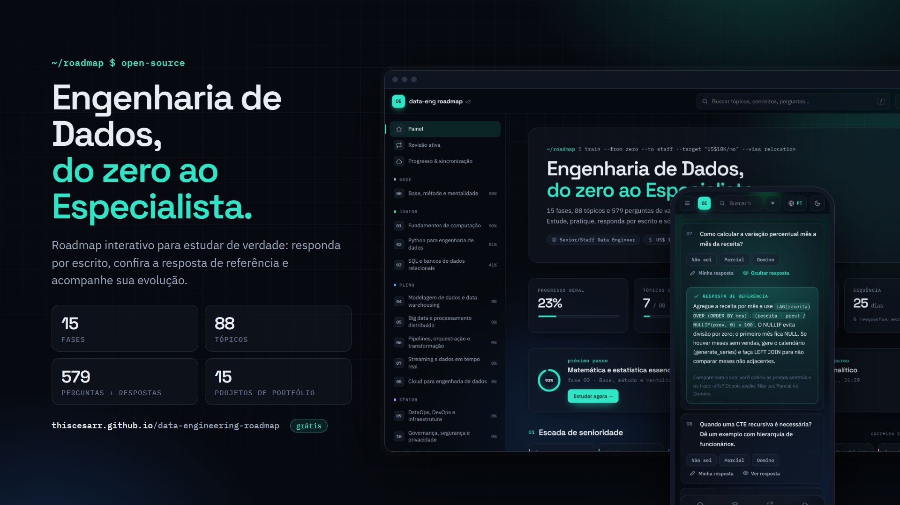
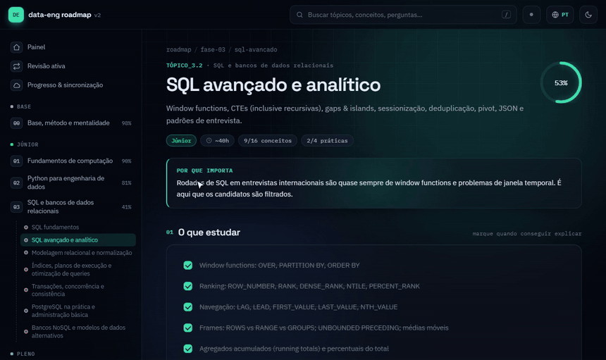

# Data Engineering Roadmap: from zero to Staff

**English** · [Português](README.pt-BR.md)

**🔗 Live site:** https://thiscesarr.github.io/data-engineering-roadmap/

[](https://thiscesarr.github.io/data-engineering-roadmap/)

An interactive, free and open-source study roadmap for **Data Engineering**, from absolute zero to **Expert / Staff** level, plus a parallel track for building an **international career** (job search, interviews in English, work visas and negotiation).

I built it to guide my own studies and track whether I actually learned each topic, not just watched content about it. If you are on the same path, use it, fork it and help improve it.

> **Language note:** the content is written natively in **Brazilian Portuguese**. The site has a one-click **EN** toggle that uses machine translation. A native English version of the content is a welcome contribution.

## What's inside

| | |
|---|---|
| **15 phases** | Foundations → Computing → Python → SQL → Data modeling → Big Data/Spark → Pipelines → Streaming → Cloud → DataOps → Governance → Architecture → ML/AI data → Staff+ → International career |
| **88 topics** | Each with *why it matters*, *what to study*, *hands-on practice*, *how to study* (study steps + ready-made searches) and *sources* (official docs, books, courses) |
| **579 validation questions** | Interview-level questions, **each with a hidden reference answer** you reveal only after answering |
| **15 portfolio projects** | One capstone per phase, with clear deliverables |
| **~900 concepts and ~240 exercises** | Checkable lists |

## Features



<sub>Screens show demo progress data.</sub>

- **Answer → check → rate:** write your answer, reveal the reference answer, then rate yourself (*Don't know / Partial / Mastered*)
- **Active review (quiz)** with spaced repetition: weak and least-recently-seen questions come back more often (`R` reveals, `1` `2` `3` rate)
- **Progress tracking** by concept, exercise, question, topic, phase and seniority level
- **Activity heatmap**, study streak, access history and projected completion date based on weekly study hours
- **Sync between phone and computer** with Google sign-in (optional)
- **Search** across topics, concepts and questions (`/`)
- **JSON backup and restore**, light/dark theme, responsive layout for phones

## Levels

| Level | Phases | Focus |
|---|---|---|
| Foundations | 0 | How to learn, the DE role, English, math and statistics |
| Junior | 1–3 | Computing, Linux, networking, Git, algorithms, Python, SQL |
| Mid-level | 4–8 | Data modeling, Spark, lakehouse, Airflow/dbt, Kafka/Flink, cloud |
| Senior | 9–12 | DataOps, Kubernetes, Terraform, governance, system design, data for AI |
| Expert / Staff | 13 | Database and query engine internals, open source, technical leadership |
| Career (parallel) | 14 | Global market, visas, résumé, interviews, negotiation, relocation |

## Privacy

Without signing in, all progress stays in your browser's `localStorage`. Nothing leaves your device.

If you sign in with Google to sync devices, your progress (checked items, ratings, written answers and history) is stored in a Firestore document that **only your account can read or write**. You can delete it at any time from the *Progress & sync* page. If you prefer not to rely on this project's Firebase, fork the repo and use your own (see below).

## Disclaimer

The content was written with the help of AI and reviewed by me, but it can still contain mistakes or outdated details. Visa rules and salary ranges change often: always confirm with official sources and current data (e.g. levels.fyi). Corrections are very welcome.

## Run locally

No build step and no dependencies. Serve the folder:

```bash
python -m http.server 8000
```

Then open `http://localhost:8000`.

## Self-host with your own sync (optional)

1. Fork the repo and enable **GitHub Pages** (Settings → Pages → branch `main`, folder `/`).
2. Create a project at [console.firebase.google.com](https://console.firebase.google.com/).
3. **Authentication** → enable the **Google** provider. Under *Settings → Authorized domains*, add your Pages domain.
4. **Firestore Database** → create the database and set these **Rules**:
   ```
   rules_version = '2';
   service cloud.firestore {
     match /databases/{database}/documents {
       match /users/{uid} {
         allow read, delete: if request.auth != null && request.auth.uid == uid;
         allow create, update: if request.auth != null && request.auth.uid == uid
           && request.resource.data.data is string
           && request.resource.data.data.size() < 800000;
       }
     }
   }
   ```
5. **Project settings → Your apps → Web**: copy the `firebaseConfig` values into `data/firebase-config.js`. Set it to `null` to disable sync.

The Firebase web config is not a secret. Data is protected by the rules above. On the free (Spark) plan there is no billing; if the daily quota runs out, sync pauses until the next day and local progress keeps working.

## Project structure

```
index.html        # app shell
styles.css        # styles (light/dark)
app.js            # routing, rendering, state, merge and quiz
sync.js           # Google sign-in + Firestore (loaded only when configured)
data/
  00-base.js … 14-carreira.js   # content, one file per phase
  respostas/                    # reference answers (same order as the questions)
  kw.js                         # English search terms per topic
  firebase-config.js            # public Firebase config (or null)
```

## Contributing

Found a wrong answer, a broken link or a missing topic? Open an issue or a pull request. See [CONTRIBUTING.md](CONTRIBUTING.md).

## License

MIT
